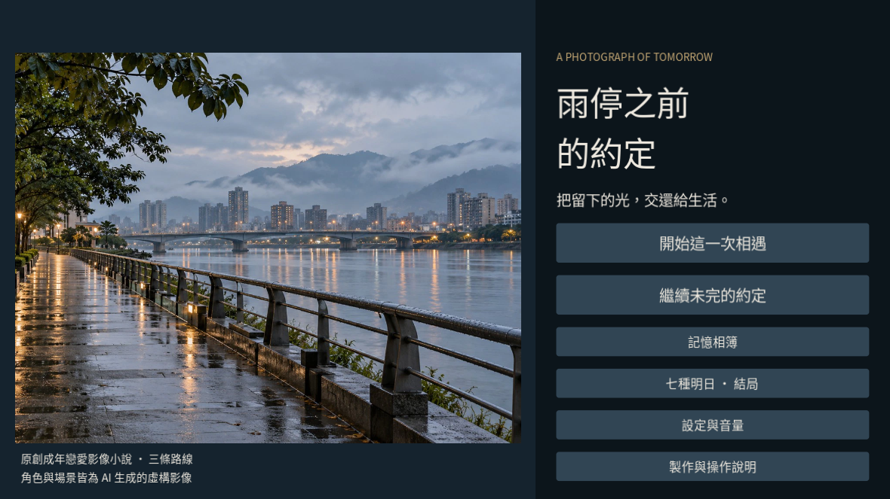
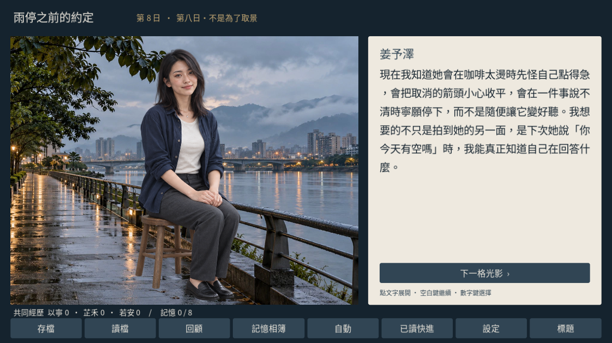
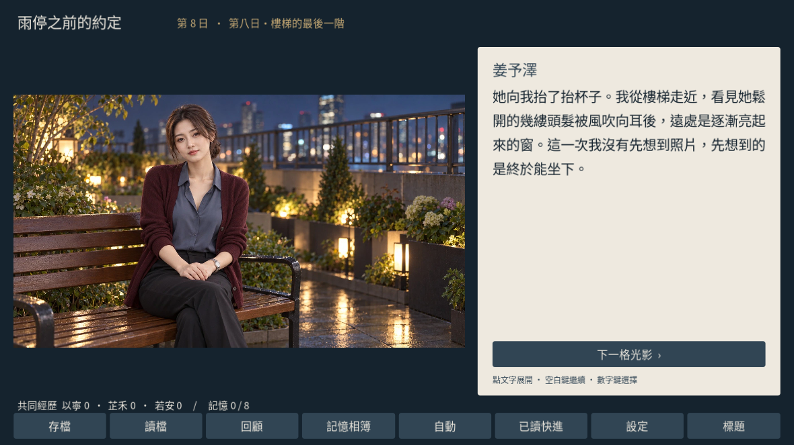

# 雨停之前的約定 · Rain Promises

一部原創繁體中文成年戀愛影像小說，以雨城的社區影像展為起點，描寫攝影、工作、界線與親密關係。使用 Godot 4.6.3，16:9 攝影分鏡介面。

角色與場景皆為 AI 生成的虛構影像，沒有真人演出，也未採集真人照片。不是《潮汐書店的七封信》的故事或素材換皮；本作有獨立角色、完整新故事、寫實攝影美術及四首新配樂。通用存讀檔與 UI 工具經重新設計後沿用。

## 1.0.1 輕量化修訂

本修訂保留完整649節點、27張透明立繪、六背景、六CG及所有音訊。只改成完整覆蓋遊戲所需字元的改名字型子集，以及背景/CG的0.92高品質Godot紋理壓縮；圖片尺寸未降低，劇本和存檔格式不變。Windows、Linux、Web與Source套件一起重建為1.0.1，請勿混用不同版Web檔案。

修改後字型名稱為 Rain Promises CJK Subset，保留SIL OFL1.1和Adobe原著作權聲明；完整原字型位於provenance/font，說明見assets/fonts/SUBSET-NOTICE.txt。未變更字形輪廓。

## 下載與執行

- 線上版：公開部署後的 GitHub Pages；本儲存庫提供 Godot 原始碼。
- Windows：解壓另行交付的 `RainPromises-Windows.zip`，執行 `RainPromises.exe`。未簽章的原創遊戲可能顯示系統提醒；不需要關閉系統安全功能。
- Linux x86_64：解壓 `RainPromises-Linux.zip`，如需執行權限，執行 `chmod +x RainPromises.x86_64`，再啟動。
- 原始碼：使用 Godot 4.6.3 匯入 `project.godot`，按 F6/F5 執行。
- Web 套件：以 HTTP(S) 靜態伺服器提供 `builds/web`，開啟 `index.html`；不支援直接以 `file://` 開啟。

公開頁面只提供 Web 遊玩與原始碼；預製桌面套件透過私人 OneDrive 另行交付，不放於本公開儲存庫或 GitHub Releases。

## 角色

- 姜予澤，29 歲，攝影師。玩家視角男主角。
- 夏以寧，28 歲，天文館教育員。
- 許芷禾，30 歲，陶藝師。
- 宋若安，31 歲，急診醫師。

所有主要人物皆為虛構成年人。三條人物路線、七個結局與八項記憶收藏。友情不是失敗結局；拒絕被拍攝或公開影像不扣互信。行程與攝影選擇影響相遇、記憶與後續對話；戀愛需要兩項實質互信與清楚表達的意向。

## 操作與功能

- 滑鼠或觸控按鈕操作；空白鍵／Enter 繼續；數字鍵選擇；Esc 開關選單。
- 點文字先顯示全文。較長文字可捲動，避免選項遮擋角色或文字。
- 三個手動槽及一個自動槽。每進入新段落自動保存；讀檔不重複增加互信、旗標或收藏。
- 對話回顧、跨周目記憶相簿、七個結局解鎖紀錄。
- 自動閱讀與只略過已讀段落的快進，選項前會停下；選單開啟時暫停。
- 文字速度、獨立配樂與環境／操作音效音量，以及全域靜音。
- 四種情緒配樂隨故事切換，1.4 秒等功率淡入淡出；背景音樂和雨聲循環。

網頁存檔存於目前瀏覽器與裝置。清除網站資料、隱私模式、儲存額度不足等可能導致進度不能保存。程式會提示寫入失敗。存檔使用獨立遊戲識別碼與版本，拒絕格式錯誤或其他作品的檔案，不會靜默套用。

## 內容量與閱讀時間

全稿共 33,075 漢字（含標點等可見字元 36,772），649 個節點。完整人物路線約 36–64 分鐘，獨身路線約 28–43 分鐘，均為文字量估算。完整 200 條合法路徑的精確字數與估時見 `provenance/story/validation_report.md` 與 `tests/QA_REPORT.md`。上述估算 = 漢字 ÷ 每分鐘 500–300 字 + 每個節點 1.5 秒 + 每個選擇 15 秒；不是玩家實測時長。全部分支不會在單次遊玩中出現。`tests/story_report.json` 另外提供可見 Unicode 字元與條件圖交叉檢查。

## 視覺資產

- 每位女主角 9 張透明立繪：站姿 neutral/smile/thoughtful、坐姿 neutral/smile/sad、動作 neutral/surprised/determined，共 27 張。
- 六張獨立場景：天文館、河岸、工坊、咖啡館、車站、展廳。
- 六張情境 CG：每位角色兩張。屋頂與醫院外景在普通對話時明確使用河岸／車站的氣氛場景別名；屋頂特寫另有專用 CG。不宣稱八張獨立背景。
- Runtime 立繪為保真 alpha WebP，背景／CG 為 JPEG。原始生成圖、角色 master、提示、資產清單保留於 `provenance/art`，不打包至執行版。
- 原始影像皆由內建影像生成工具製作。生成影像可能存在細微視覺不一致；未聲稱是真人相片或紀錄影像。

## 音訊、來源與授權

配樂為明確編排的原創旋律、和聲、低音與音色合成，無第三方錄音、樣本或音色庫。四首主題各約 65–76 秒，另有雨景與三種操作音效。作曲腳本、WAV 原檔、OGG、頻率／響度／解碼／接點驗證見 `provenance/audio`。

音樂已通過解碼、峰值、無 clipping、循環接點與 hash 客觀測試。測試環境沒有音訊輸出裝置，Godot 使用 dummy audio driver；僅驗證串流、音量與切換狀態。沒有完成真人聽審，不宣稱專業母帶或主觀聽覺 QA 已通過。沒有角色語音。

- 專案原創程式、文字與提供的生成素材：MIT，限授權者依法持有的權利範圍；不保證 AI 生成內容具有排他著作權。
- Godot 4.6.3：MIT，https://godotengine.org/license/
- Noto Sans CJK TC：SIL Open Font License 1.1；授權原文位於 `assets/fonts`，https://github.com/notofonts/noto-cjk

## 重建與驗證

1. `python tests/validate_story.py`：驗證無環圖、條件、合法結局路徑及所有美術參照。
2. `godot --headless --path . --editor --import --quit`：匯入資產。
3. `godot --headless --path . --script res://tests/engine_test.gd`：驗證存讀檔、壞資料、重複效果、選單暫停、已讀快進及七條合法結局路徑。請使用測試專用的 XDG_DATA_HOME，避免覆寫自己的存檔。
4. 安裝官方 Godot 4.6.3 匯出模板後，執行 `python tools/build_release.py`，可透過 `RAIN_OUTPUT` 指定輸出位置。發布前另執行原生畫面與互動 QA。

匯出包含 Windows x86_64、Linux x86_64、Web 單執行緒版本。Web 需要 WebGL 2；不需要 cross-origin isolation。測試環境若無 WebGL 2，只能驗證降級提示與靜態檔案，不代表遊戲 Web runtime 已被實際遊玩。

## 畫面

以下截圖來自實際 Linux 匯出執行檔，非概念稿。

## 已驗證與限制

Linux 原生畫面與互動已實測；Windows 套件完成交叉匯出但未在 Windows 實際啟動。Web 靜態資產與 WebGL 2 缺失提示可驗證，本環境不具 WebGL 2，未宣稱 Web 遊戲實畫面 QA 通過。未在真實手機觸控裝置測試。完整獨立 QA 結論見 `tests/QA_REPORT.md`。
